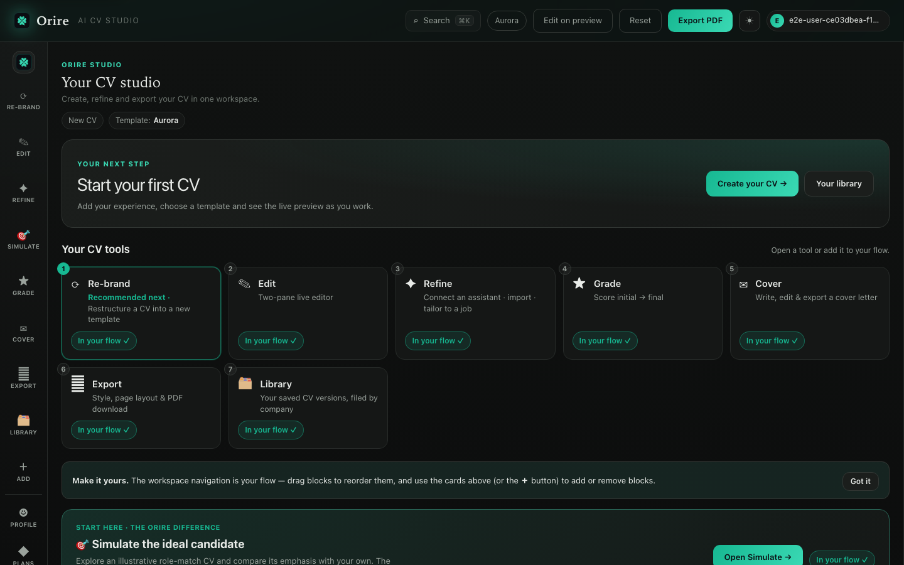
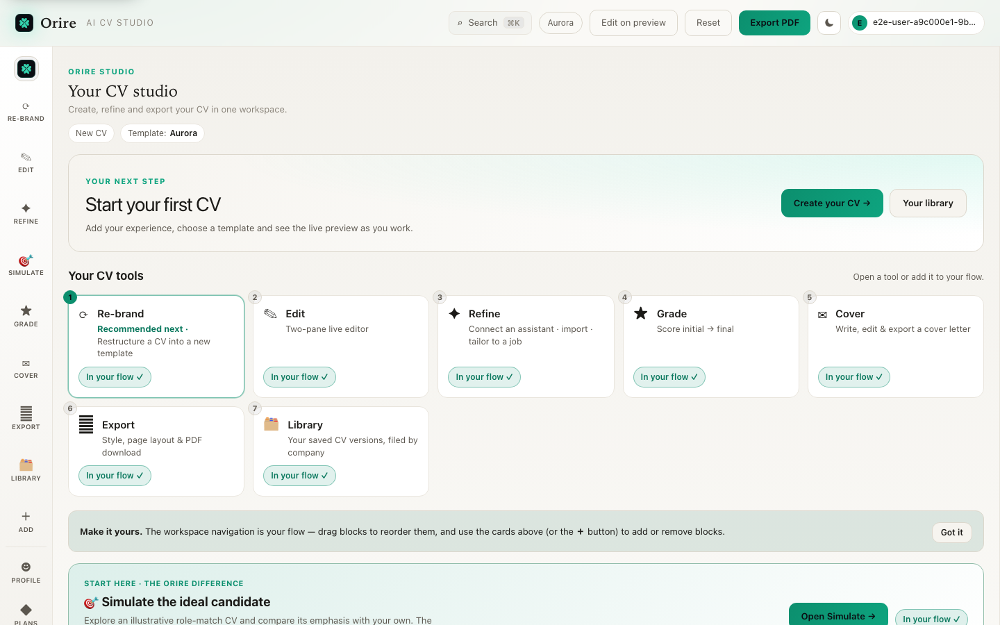
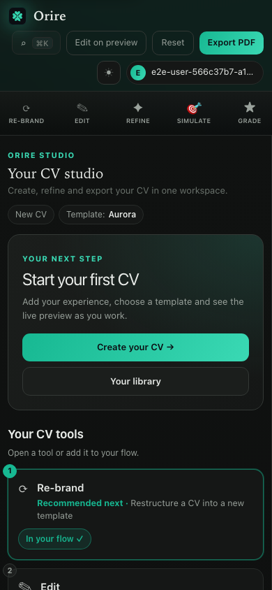
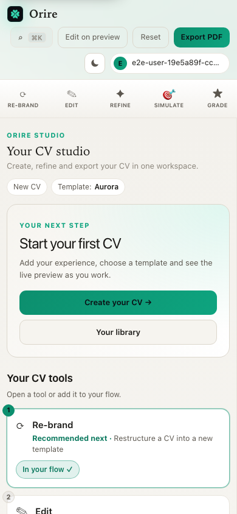

# #151 — approved Studio hierarchy redesign

The owner approved the concrete desktop/mobile, dark/light [screenshot proposal](PROPOSAL.md) in the task chat before implementation. Local production-build screenshots were explicitly accepted for this batch. Earlier Studio entry actions from merged #155/#171 were reviewed and reused; this implements the further approved hierarchy rather than repeating those changes.

## Implemented behavior

- The Studio introduction is concise and shows actual current CV/template context. A fresh workspace says **New CV**; a started document shows its real name, or **Untitled CV** when blank. No saved record, sync status or progress percentage is invented.
- The existing Create/Continue and Library actions remain in a compact next-step panel.
- A named **Your CV tools** section appears immediately afterward. Existing tool order, recommendations, flow toggles and plan checks are preserved.
- Flow guidance and Simulate follow the tools. Guidance refers accurately to the cards above it and works on desktop/mobile navigation.
- Keyboard order follows visual order. Focus uses the existing readable emerald token. Reduced motion removes Studio reveal/hover movement, including pre-hydration styles. Header/rail, editor/live preview, account, subscription and export logic are unchanged.

## BEFORE — actual Orire render

Source main `a86d65c1c267927b1b1b26c529e59e964a061d2e`, local production build `cpjbIOE3tVdzeLOcB00A7`, Chromium 153.0.8010.12. Real fresh fictional account state, denied optional analytics, onboarding seen, reduced motion. Source fingerprints and capture details are in [proposal provenance](proposal-provenance.json). No production records were used.

| Viewport/theme | BEFORE — actual | AFTER — proposed, NOT implemented |
| --- | --- | --- |
| Desktop 1440×900 dark | [Before](BEFORE-actual-for-proposal-studio-desktop-dark.png) | [Approved proposal](AFTER-proposed-NOT-implemented-studio-desktop-dark.png) |
| Desktop 1440×900 light | [Before](BEFORE-actual-for-proposal-studio-desktop-light.png) | [Approved proposal](AFTER-proposed-NOT-implemented-studio-desktop-light.png) |
| Mobile 390×844 dark | [Before](BEFORE-actual-for-proposal-studio-mobile-dark.png) | [Approved proposal](AFTER-proposed-NOT-implemented-studio-mobile-dark.png) |
| Mobile 390×844 light | [Before](BEFORE-actual-for-proposal-studio-mobile-light.png) | [Approved proposal](AFTER-proposed-NOT-implemented-studio-mobile-light.png) |

The proposals are temporary browser DOM/CSS modifications of the corresponding actual page. They are explicitly distinct from actual application source. [Exact proposal CSS](proposal.css.txt) and [full-page proposal links](PROPOSAL.md) make below-fold controls reviewable. The historical initial brief predates shipped work; it is not the current implementation status.

## AFTER — actual browser render

Actual captures are from verified source commit `c9745210ad43ff7aafc2a816ed90d7dc58937e41`. [After provenance](after-provenance.json) records source hashes, build ID, browser and six viewport/theme contexts, all HTTP 200 with zero browser page errors. These are genuine application renders with no injected DOM/CSS. No deployed-preview inspection is claimed; owner-authorized local evidence is used for this batch.

| Viewport | Actual dark | Actual light |
| --- | --- | --- |
| Desktop 1440×900 |  |  |
| Mobile 390×844 |  |  |
| Narrow mobile 320×844 | [Actual dark](AFTER-actual-studio-narrow-dark.png) | [Actual light](AFTER-actual-studio-narrow-light.png) |

Below-fold review: full-page actual [desktop dark](AFTER-actual-full-studio-desktop-dark.png) / [desktop light](AFTER-actual-full-studio-desktop-light.png) / [mobile dark](AFTER-actual-full-studio-mobile-dark.png) / [mobile light](AFTER-actual-full-studio-mobile-light.png). These show the retained flow coach, Simulate and reset actions after the tools. The implementation matches the approved hierarchy/compactness; guidance now accurately refers to cards above it and workspace navigation on either device.

## Verification

All required checks ran on the independent issue branch against disposable loopback PostgreSQL. [Exact command/exit/timestamp record](verification.json):

| Command | Final result |
| --- | --- |
| `npm run lint` | Exit 0; one existing unused `ProviderId` warning |
| `npx next typegen` | Exit 0 |
| `npx tsc --noEmit` | Exit 0 |
| `npm test` | Exit 0; **560 passed, 80 files** |
| `npm run build` | Exit 0 |
| `npm run test:e2e` | Exit 0; **145 passed, one unchanged mobile download skip, 1.4m, no retries** |

Ten additional E2E cases cover hierarchy, keyboard order, no horizontal overflow and axe checks at 1440/390/320px in both themes; named/blank real cloud document resume with actual template and retained editor value; relocated flow/coach/Simulate actions; and exhausted free Simulate access still routing to Plans. Existing Studio actions, editor/preview, export, auth and subscription regressions remain in the complete suite. No assertions were loosened, tests disabled or timeouts increased.

The initial new quota test used a standard UUID E2E identity, which intentionally receives an unlimited usage snapshot, so its upgrade expectation failed. The final test uses its own verified fictional identity outside that bypass, seeds the actual stored free quota, asserts the real Plans routing, closes its context and deletes only its own account. All six required commands were rerun after correcting the test setup. No billing behavior or bypass policy was changed to satisfy the test. No production database, real payment, external AI call or customer data was used.
