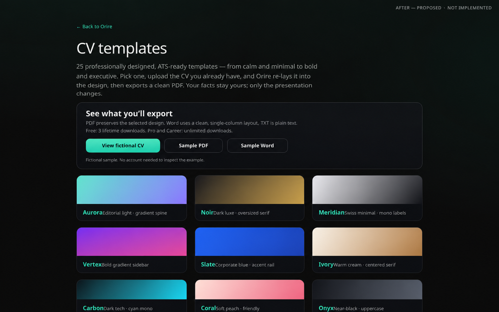
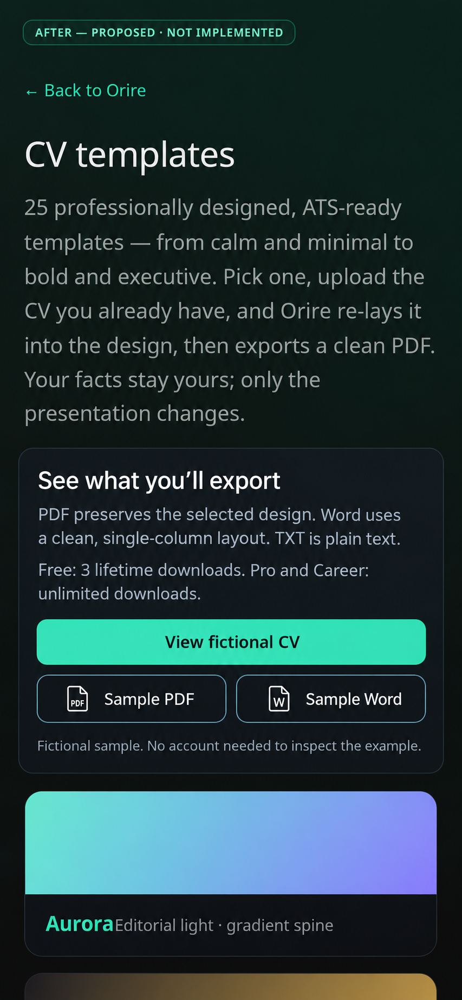

# #91 — public export confidence proposal

Status: **PROPOSAL ONLY — NOT IMPLEMENTED**. Owner approval is required before product UI changes.

## Intent

Let a visitor inspect a representative fictional CV and the actual PDF/Word output before signing up. Keep Orire's existing graphite/emerald identity, content width, typography, template cards and real Aurora CV rendering. Do not replace the application with an invented interface.

## Proposed change

Add one compact export-confidence panel between the existing `/templates` introduction and catalog:

- Heading: **See what you'll export**.
- Link **View fictional CV** opens the existing Aurora preview.
- Links **Sample PDF** and **Sample Word** would download newly generated, sanitized examples. These links are a proposal; no sample asset or download endpoint is implemented in this branch.
- Explain: **PDF preserves the selected design. Word uses a clean, single-column layout. TXT is plain text.** Do not imply Word is a pixel-matched template clone.
- Explain the verified policy: **Free: 3 lifetime downloads. Pro and Career: unlimited downloads.** Derive future implemented limits from canonical plan policy instead of hardcoding divergent marketing rules.
- Identify all sample information as fictional. Sample downloads would require no account, but visitors' own exports retain existing authentication/email-verification and server authorization gates.

The existing gallery and its links remain. This proposal does not change the broader ATS or AI wording; those claims need their own review rather than a silent unrelated rewrite.

## Source verification

- `src/components/templates/TemplateDetailPreview.tsx` already renders the genuine template with `sampleCV` and labels it fictional.
- `src/components/export/ExportView.tsx` exports PDF, Word and TXT, describes PDF as a visual snapshot, and explicitly describes Word as single-column content rather than a template clone.
- `src/lib/plan/plan.ts`: Free has three lifetime downloads; paid plans have unlimited downloads. Formats are not a paid-only differentiator.
- DOCX sample generation must use the existing exporter and sample CV, not a hand-invented document that suggests unsupported layout fidelity.

## Implementation gates after approval

1. Generate sanitized sample PDF and DOCX through current Orire export paths, with full-structured-CV PDF metadata disabled for the public example. Validate extractable text, file type, links and fictional values. Review output visually.
2. Add only the approved export panel and public sample links; preserve real-account export gates and metering.
3. Test anonymous preview/sample access, keyboard/link names, file content and plan copy; run lint, TypeScript, unit, build and browser regression.
4. Capture **AFTER — implemented screenshot (PR commit)** at the same browser, theme and desktop/mobile viewports as the approved proposal. Attach evidence on issue #91 and the implementation PR.
5. Use `Fixes #91` only when the complete acceptance criteria are met; this proposal alone references the issue and does not close it.

## Evidence

### BEFORE — actual Orire render

Source application commit: `48fa224703aaf6e219fd01f2e3218b81b5518baf` (merged #131–#133 baseline). Captured 23 October 2026 at 16:14 UTC using Chromium `154.0.8037.57`, dark theme, reduced motion, denied optional analytics, `en-GB` locale and `Europe/Lisbon` timezone. Desktop viewport **1440×900**; mobile **390×844**. Capture source was the local production baseline server on port 3493, not an independently inspected external deployment. All four requests returned HTTP 200 with zero browser page errors. See [capture provenance](capture-provenance.json).

| Source viewport | Actual templates index | Actual fictional Aurora preview |
| --- | --- | --- |
| Desktop 1440×900 | [Before index](BEFORE-actual-templates-desktop-1440.png) | [Before preview](BEFORE-actual-aurora-desktop-1440.png) |
| Mobile 390×844 | [Before index](BEFORE-actual-templates-mobile-390.png) | [Before preview](BEFORE-actual-aurora-mobile-390.png) |

The index desktop/mobile and Aurora mobile assets were opened and visually inspected. The Aurora screenshot is the application's real existing fictional CV, including its right skills sidebar; this proposal does **not** claim Aurora is single-column. Existing Aurora detail copy calls it “one-column” despite that sidebar. That source-content mismatch is a separate template/editorial follow-up, not silently fixed by this proposal. The proposed Word explanation describes the actual Word exporter, not the Aurora visual layout.

### AFTER — proposed mockup (source: before screenshot)

These images were made with `image_gen` edits using the exact corresponding actual templates-index screenshot as reference. They retain the existing page identity, introduction and catalog; the intended addition is only the export-confidence panel. They are **design proposals, not application screenshots, implemented UI, working sample downloads, or pixel-regression baselines**.

| Desktop proposal | Mobile proposal |
| --- | --- |
| [After — proposed desktop](AFTER-proposed-templates-desktop.png) | [After — proposed mobile](AFTER-proposed-templates-mobile.png) |





**Graphical/implementation difference:** the generator resampled the source canvas and slightly approximated existing catalog-card spacing. Treat panel hierarchy, wording and responsive control grouping as the proposed change; do not implement its incidental card resizing or font differences. The future CSS implementation must retain the existing catalog styles and may naturally push lower cards out of the same viewport. Exact source and generated dimensions are recorded in [proposal provenance](proposal-provenance.json). On desktop the controls form one row; on mobile the primary preview link is full-width with a PDF/Word pair below it. These are feasible HTML/CSS arrangements, subject to owner approval.

### AFTER — implemented screenshot (PR commit)

**Not available: product UI is intentionally unchanged pending owner approval.** No actual implemented-after screenshot exists. After approval, implementation must supply real browser renders from its own PR commit at the same source viewports/theme, compare them with this approved proposal, and attach them to both the issue and implementation PR.

## Reproducing the unchanged baseline capture

The committed [capture helper](capture.mjs) uses the repository's Playwright dependency, optional `ORIRE_CAPTURE_BROWSER` executable path, and `BASE_URL` (default local port 3493). It records the fixed source SHA above because this evidence belongs to that baseline; update provenance deliberately if recapturing a different application commit. Start that unmodified production build first, then run:

```sh
BASE_URL=http://127.0.0.1:3493 ORIRE_CAPTURE_BROWSER=/usr/bin/chromium node docs/visual-qa/ux91/capture.mjs
```

The browser path is a local validation override; CI's pinned browser was not replaced. Capture dimensions are fixed and optional tracking is denied. Image-generation mockups are separately derived assets, not produced by this capture helper.

## Verification and review request

This branch changes documentation and evidence only. Four real production-browser route captures returned HTTP 200 and no page errors. The image-generation outputs were inspected for wording and source fidelity; their limits are disclosed above. No signup, AI request, provider account, payment, customer record or secret configuration was used. No claim is made that the proposed sample downloads already exist or that #91 is complete.

Owner review should approve or revise the panel placement, exact format/limit wording and the public fictional PDF/Word sample concept **before** application code changes. A later implementation PR can use `Fixes #91` only after the complete acceptance criteria and real implemented evidence are satisfied.
