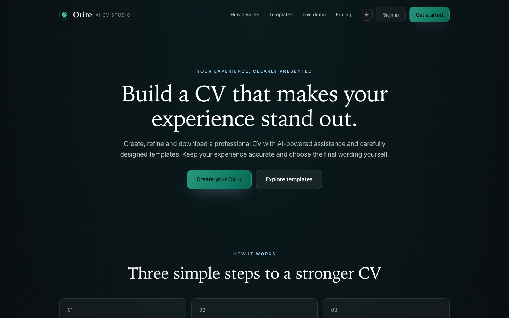
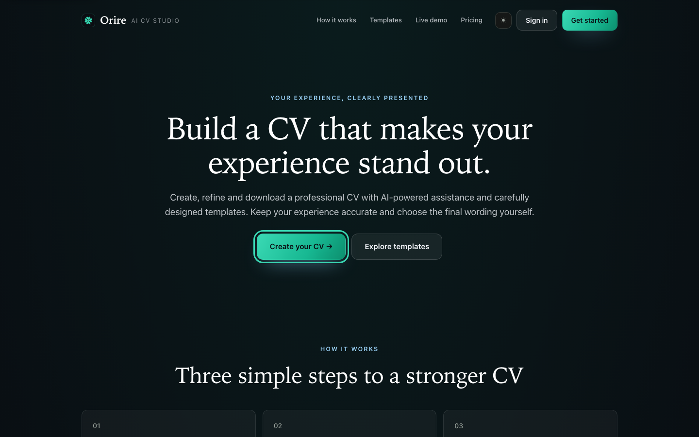
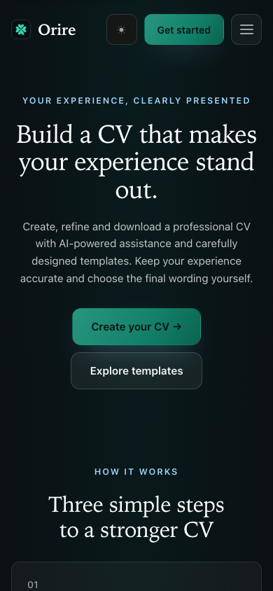
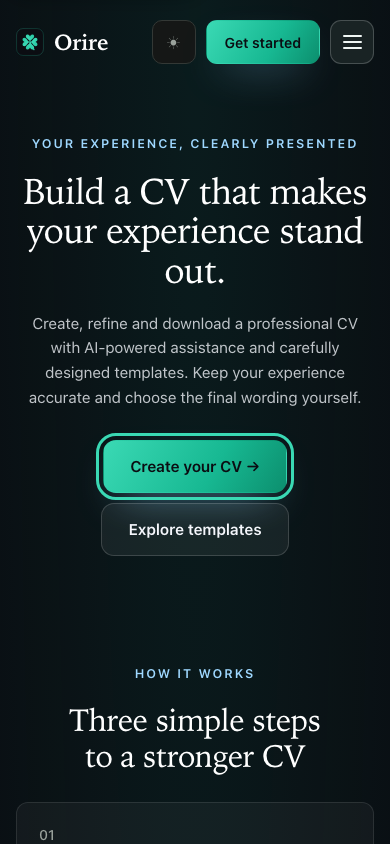

# UX #97 — landing motion and reliable first interaction

The owner approved the screenshot-based motion proposal and accepted local
production-build screenshots in the task chat before implementation. This
approval covers immediate readable hero content, reduced-motion-safe reveals
and hover feedback, explicit existing-emerald keyboard focus/pressed states,
and preventing clicks before JavaScript handlers attach. No merge or production
deployment is authorized by that approval.

## BEFORE — actual Orire render

Source main `a86d65c1c267927b1b1b26c529e59e964a061d2e`, local production
build at `http://localhost:3100`, Chromium version and source hashes in
[provenance.json](provenance.json). Dark theme, reduced motion, desktop
1440×900 and mobile 390×844. Only public fictional CV content is present.

The first-paint captures deliberately hold application `.js` requests while
allowing HTML, CSS and fonts. They reproduce the delayed-hydration condition;
they are not ordinary-network screenshots or performance measurements. The
actual hero is `opacity:0`, translated 24px and blurred 10px before hydration,
even when the browser requests reduced motion. A single click on the visible
mobile menu has no effect while handlers are absent; after scripts are released,
a fresh single click opens it. Both contexts recorded zero page/console errors.

## AFTER — proposed mockup (source: before screenshot)

These images are browser CSS modifications of that same actual Orire render,
**NOT an implemented result**. The first-paint proposal reveals the hero in its
existing final position. Focus proposals add the existing emerald 3px outline;
the original browser already supplies a default focus indicator. Proposed CSS
also removes CTA/demo hover movement under reduced motion and adds pressed
feedback. Layout, text, typography and CV design are preserved.

| State | BEFORE — actual | AFTER — proposed, NOT implemented |
| --- | --- | --- |
| Desktop delayed-script first paint |  |  |
| Mobile delayed-script first paint |  |  |
| Desktop keyboard CTA focus |  |  |
| Mobile keyboard CTA focus |  |  |

[Exact proposal overrides](AFTER-proposed-browser-overrides.css) and
[capture provenance](provenance.json) distinguish the experimental CSS from
application source. The implementation additionally presents JavaScript-only
actions as temporarily disabled until hydration; native section anchors remain
available immediately. Section reveals use one easing and a 0.5-second timing
with 0.08-second staggering under normal motion, and no movement/delay under
reduced motion. Reduced-motion CSS also applies before hydration.

## AFTER — implemented screenshot (issue branch)

Actual production-build captures from source commit
`bd08b799750db91b152cb8c881bcd4fb3cba2bbb` are separate from the proposals:

| Viewport | Actual delayed-script first paint | Actual keyboard focus |
| --- | --- | --- |
| Desktop 1440×900 |  |  |
| Mobile 390×844 |  |  |

[Actual capture provenance](after-provenance.json) records source fingerprints,
build ID, browser and computed states. Both contexts had zero page or console
errors. The hero is immediately readable; temporarily disabled JavaScript-only
buttons additionally communicate readiness before hydration. Native links stay
usable. Once enabled, one menu/CTA activation works. The local production-build
evidence policy was explicitly approved by the owner for this batch; no deployed
preview verification is claimed.

## Verification

Implementation adds regression coverage for server-rendered hero visibility
while scripts are held, disabled-to-enabled action readiness, a single first
menu/CTA activation, keyboard focus/pressed feedback, reduced-motion section
styles, template selection, and mobile menu entrance/exit. Verification results
are in [the command record](verification.json): `npm run lint`, `npx next typegen`,
`npx tsc --noEmit`, `npm test`, `npm run build` and `npm run test:e2e` all exited 0
on the isolated issue branch. Unit tests: **560 passed, 80 files**. Full E2E:
**139 passed, one unchanged mobile download skip, 1.4m, no retries**. Lint has one
pre-existing unused `ProviderId` warning. Verification used the disposable local
PostgreSQL database with unique fictional fixture identities; no production
database, external AI or payment call was used. No test is disabled and no
timeout is increased. The existing mobile-menu reduced-motion regression also
passed on its first attempt.
