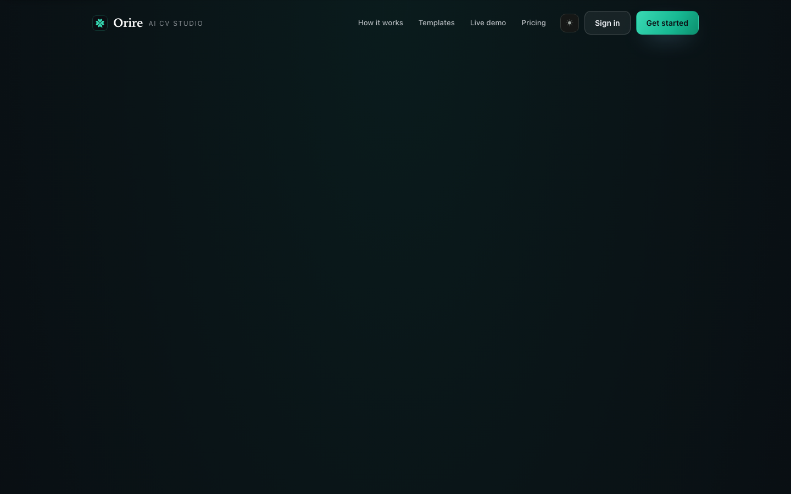
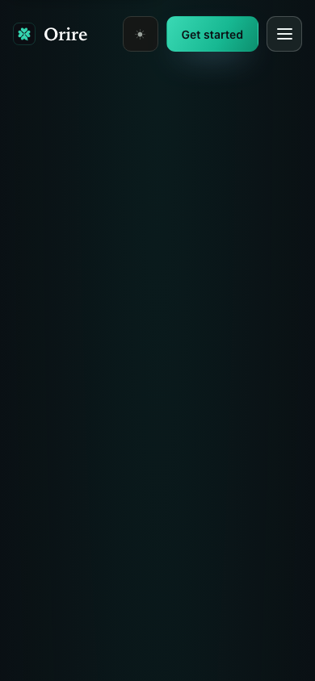

# UX #97 — landing motion and reliable first interaction

The owner approved the screenshot-based motion proposal and accepted local
production-build screenshots in the task chat before implementation. This
approval covers immediate readable hero content, reduced-motion-safe reveals
and hover feedback, explicit existing-emerald keyboard focus/pressed states,
and preventing clicks before JavaScript handlers attach. No merge or production
deployment is authorized by that approval.

## BEFORE — actual Orire render

Source main `a86d65c1c267927b1b1b26c529e59e964a061d2e`, local production
build at `http://localhost:3100`, Chromium version and source hashes in
[provenance.json](provenance.json). Dark theme, reduced motion, desktop
1440×900 and mobile 390×844. Only public fictional CV content is present.

The first-paint captures deliberately hold application `.js` requests while
allowing HTML, CSS and fonts. They reproduce the delayed-hydration condition;
they are not ordinary-network screenshots or performance measurements. The
actual hero is `opacity:0`, translated 24px and blurred 10px before hydration,
even when the browser requests reduced motion. A single click on the visible
mobile menu has no effect while handlers are absent; after scripts are released,
a fresh single click opens it. Both contexts recorded zero page/console errors.

## AFTER — proposed mockup (source: before screenshot)

These images are browser CSS modifications of that same actual Orire render,
**NOT an implemented result**. The first-paint proposal reveals the hero in its
existing final position. Focus proposals add the existing emerald 3px outline;
the original browser already supplies a default focus indicator. Proposed CSS
also removes CTA/demo hover movement under reduced motion and adds pressed
feedback. Layout, text, typography and CV design are preserved.

| State | BEFORE — actual | AFTER — proposed, NOT implemented |
| --- | --- | --- |
| Desktop delayed-script first paint |  |  |
| Mobile delayed-script first paint |  |  |
| Desktop keyboard CTA focus |  |  |
| Mobile keyboard CTA focus |  |  |

[Exact proposal overrides](AFTER-proposed-browser-overrides.css) and
[capture provenance](provenance.json) distinguish the experimental CSS from
application source. The implementation additionally presents JavaScript-only
actions as temporarily disabled until hydration; native section anchors remain
available immediately. Section reveals use one easing and a 0.5-second timing
with 0.08-second staggering under normal motion, and no movement/delay under
reduced motion. Reduced-motion CSS also applies before hydration.

## AFTER — implemented screenshot (issue branch)

Pending the issue branch's production build and actual browser capture. The
proposal images above must not be used as implemented evidence. Final captures
will identify the source commit/hashes, use matching viewports/theme, and record
console errors. No deployed preview verification is claimed here.

## Verification

Implementation adds regression coverage for server-rendered hero visibility
while scripts are held, disabled-to-enabled action readiness, a single first
menu/CTA activation, keyboard focus/pressed feedback, reduced-motion section
styles, template selection, and mobile menu entrance/exit. Verification results
will be recorded only after commands actually execute against the final build.
No test is disabled and no timeout is increased.
